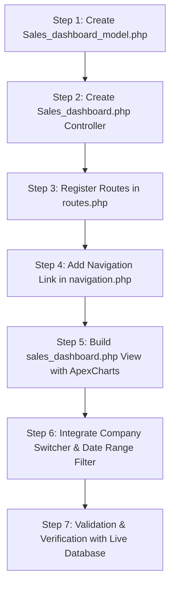

# Sales Dashboard — Architecture & Implementation Plan

## 1. Executive Summary & Objective

The objective is to design and implement a dedicated **Company-Wise Sales & Financial Performance Dashboard** in the Machenix ERP system (CodeIgniter 3 + MariaDB/MySQL + Bootstrap 5 / Vuexy theme).

This dashboard is dedicated to high-level management and sales visibility. It evaluates real-time business health for the **currently active session company (`company_id`)**, without staff-level record restriction (`sale_person_id` or `added_by_id`).

### Core Business Pillars
1. **Sales Performance**:
   - Split by **White (Tax/Bill)** and **Black (Non-Tax/Cash)**.
   - Dual-perspective reporting: **Sales Amount (₹)** and **Stock / Quantity (Pcs/Units)**.
   - Gross Sales, Returns (`goods_return`), and Net Sales.
2. **Payment Collection**:
   - Split by **White (Official)** and **Black (Unofficial)**.
   - Broken down into **Cash** and **Bank (Cheque)** separately (4-way collection matrix).
   - Inflow payments vs. Customer refunds/returns.
3. **Current Balance On Hand (Liquid Funds Snapshot)**:
   - **Cash on Hand**: Official, Unofficial, and Total Cash.
   - **Bank Balance on Hand**: Official, Unofficial, Total Bank, and Account-wise breakdown.
   - Total Liquid Reserve (Cash + Bank).
4. **Architectural Separation**:
   - Dedicated Controller: `Sales_dashboard.php`
   - Dedicated Model: `Sales_dashboard_model.php` (keeping it completely decoupled from the 41,000-line `Inventory_model.php`)
   - Dedicated View: `sales_dashboard.php`
   - Dedicated Navigation item in the sidebar menu.

---

## 2. Existing Database Mapping & Business Logic Analysis

Based on codebase analysis, the Machenix database structures "White vs. Black" and financial balances as follows:

### A. Sales Transactions (`sales_order`, `sales_order_product_batch`, `goods_return`)
| Dimension | White (Bill / Tax) | Black (Unofficial / Cash) | Total / Combined |
| :--- | :--- | :--- | :--- |
| **Sales Order Header** | `so.net_sales_value_1` (Basic + GST) | `so.total_black_amt` | `so.grand_total` |
| **Tax / Breakdown** | `so.basic_value`, `so.gst_total` | — | `so.net_sales_value_2` |
| **Item Batch Amount** | `sob.bill_total` / `sob.total_bill_gst_amount` | `sob.black_total` | `sob.final_total` |
| **Stock (Quantity)** | `SUM(sob.white_qty)` | `SUM(sob.black_qty)` | `SUM(sob.white_qty + sob.black_qty)` |
| **Returned Stock** | `SUM(sob.return_qty)` | `SUM(sob.return_black_qty)` | `SUM(sob.return_qty + sob.return_black_qty)` |
| **Sales Returns (Header)** | `gr.white_total + gr.gst_total_amt` | `gr.black_total` | `gr.grand_total` |

**Filtering Criteria for Sales**:
- `so.company_id = '$company_id'`
- `so.is_deleted = '0'`
- `(so.is_cancelled = 0 OR so.is_cancelled IS NULL)`
- Filtered by `DATE(so.date) BETWEEN '$from_date' AND '$to_date'`
- **No staff filtering**: Do NOT restrict by `sale_person_id` or `added_by_id`.

---

### B. Payment Collections (`customer_payment`)
In this ERP, collections from customers are stored in `customer_payment`:
- `company_id = '$company_id'`
- `is_deleted = 0`
- `type = 'customer'` (or `manual` receipts if applicable)
- Inflow vs. Outflow:
  - `payment_mode = 'payment'` (Collection received from customer)
  - `payment_mode = 'return'` (Refund returned to customer)
- White vs. Black:
  - `payment_type = 'official'` -> **White Collection**
  - `payment_type = 'unofficial'` -> **Black Collection**
- Cash vs. Bank:
  - `LOWER(payment_method) = 'cash'` -> **Cash Collection**
  - `LOWER(payment_method) = 'cheque'` -> **Bank Collection** (In the database enum, `'cheque'` denotes bank transactions/RTGS/NEFT/cheque)

#### 4-Way Collection Matrix:
1. **White Cash Collection**: `payment_type = 'official' AND payment_method = 'cash'`
2. **White Bank Collection**: `payment_type = 'official' AND payment_method = 'cheque'`
3. **Black Cash Collection**: `payment_type = 'unofficial' AND payment_method = 'cash'`
4. **Black Bank Collection**: `payment_type = 'unofficial' AND payment_method = 'cheque'`

---

### C. Cash and Bank Balance Currently on Hand (Real-time Snapshot)
Unlike sales and collections which are periodic (date-range filtered flows), **Cash on Hand** and **Bank Balance** represent the **current real-time snapshot** of liquid assets available to the company today.

The ERP follows the audited formula in `Inventory_model::get_cash_in_hand_summary()` and `Inventory_model::get_bank_in_hand_summary()`:

#### 1. Cash in Hand Formula:
$$\text{Cash on Hand} = \text{Cash Inflows} - \text{Cash Outflows}$$
- **Inflows (+)**:
  - Customer Cash Payments (`customer_payment` WHERE `payment_method = 'cash'` AND `payment_mode = 'payment'`)
  - Manual Cash Receipts (`customer_payment` WHERE `type = 'manual'` AND `payment_mode = 'payment'`)
  - Inter-company Cash Received (`transferred_cash` WHERE `company_to_id = '$company_id'`, `method_to = 'cash'`, `is_approved = 1`)
  - Converted Cash In (`converted_payment` WHERE `company_id = '$company_id'`, `method_to = 'cash'`)
- **Outflows (-)**:
  - Customer Cash Returns/Refunds (`customer_payment` WHERE `payment_method = 'cash'` AND `payment_mode = 'return'`)
  - Manual Cash Transfers Out (`customer_payment` WHERE `type = 'manual'` AND `payment_mode = 'return'`)
  - Supplier Cash Payments & Expenses (`payments` WHERE `company_id = '$company_id'`, `payment_method = 'cash'`)
  - Vendor Cash Payments (`vendor_payments` WHERE `company_id = '$company_id'`, `payment_method = 'cash'`)
  - Inter-company Cash Sent (`transferred_cash` WHERE `company_id = '$company_id'`, `method_from = 'cash'`)
  - Converted Cash Out (`converted_payment` WHERE `company_id = '$company_id'`, `method_from = 'cash'`)

Split into:
- **Official Cash on Hand**
- **Unofficial Cash on Hand**
- **Total Cash on Hand**

#### 2. Bank in Hand Formula:
Same accounting ledger logic applied where `payment_method = 'cheque'`:
$$\text{Bank in Hand} = \text{Bank Inflows} - \text{Bank Outflows}$$
Split into:
- **Official Bank Balance**
- **Unofficial Bank Balance**
- **Total Bank Balance**
- **Account-wise breakdown** from `bank_accounts` (`id, bank_name, account_no`).

---

## 3. Architecture & Modular Structure

To keep the application clean, maintainable, and high-performing, we isolate the Sales Dashboard into its own controller, model, and view.

```
application/
├── controllers/
│   └── Sales_dashboard.php             <-- Dedicated Controller
├── models/
│   └── Sales_dashboard_model.php       <-- Dedicated Model (Optimized queries)
├── views/
│   └── backend/
│       ├── inventory/
│       │   ├── sales_dashboard.php     <-- Dedicated Dashboard View
│       │   └── navigation.php          <-- Updated with "Sales Dashboard" link
│       └── admin/
│           └── navigation.php          <-- Optional link for admin role
└── config/
    └── routes.php                      <-- Clean routing definitions
```

---

## 4. Detailed Component Specifications

### A. Dedicated Controller: `application/controllers/Sales_dashboard.php`
- **Class**: `Sales_dashboard extends CI_Controller`
- **Session Check**: Ensures `inventory_login` or `admin_login` is active; redirects to `login` if not.
- **Company Context**:
  ```php
  $company_id = (int)$this->session->userdata('company_id');
  ```
  If `company_id` is empty, auto-fetches the first available company from `common_model->getSessionCompanies()` or prompts selection.
- **Filter Parsing**:
  - `period`: `today`, `yesterday`, `this_week`, `this_month` (default), `last_month`, `this_year`, `custom`
  - `from_date` & `to_date`: Parsed from `period` or custom date-range picker.
- **Action Methods**:
  1. `index()`: Loads dashboard layout, summary stats, graphs data, and recent tables.
  2. `get_data_ajax()`: Returns JSON containing refreshed metric cards and chart datasets upon date-filter changes without a full page reload.
  3. `export_sales_summary()`: Optional CSV export for accounting/audit.

---

### B. Dedicated Model: `application/models/Sales_dashboard_model.php`
Optimized query methods strictly scoped to `company_id`:

#### 1. `get_sales_metric_summary($company_id, $from_date, $to_date)`
Returns:
- **White Sales Amount** (`SUM(so.net_sales_value_1)`)
- **Black Sales Amount** (`SUM(so.total_black_amt)`)
- **Gross Sales Amount** (`SUM(so.grand_total)`)
- **Tax Collected** (`SUM(so.gst_total)`)
- **Sales Return Amount** (White Return, Black Return, Total Return from `goods_return`)
- **Net Sales Amount** = Gross Sales - Total Return
- **Total Invoices / Orders Count**

#### 2. `get_sales_stock_summary($company_id, $from_date, $to_date)`
Returns:
- **White Stock Sold (Qty)**: `SUM(sob.white_qty)`
- **Black Stock Sold (Qty)**: `SUM(sob.black_qty)`
- **Total Stock Sold (Qty)**: `SUM(sob.white_qty + sob.black_qty)`
- **Returned Stock (Qty)**: White returned qty, Black returned qty from `goods_return_product`
- **Net Stock Sold (Qty)** = Total Stock Sold - Returned Stock
- **Average Realization per Unit (₹/Qty)**: Total Sales / Total Stock Qty

#### 3. `get_payment_collection_summary($company_id, $from_date, $to_date)`
Returns the 4-way collection matrix:
- **White Cash**: `payment_type = 'official' AND payment_method = 'cash'`
- **White Bank**: `payment_type = 'official' AND payment_method = 'cheque'`
- **Black Cash**: `payment_type = 'unofficial' AND payment_method = 'cash'`
- **Black Bank**: `payment_type = 'unofficial' AND payment_method = 'cheque'`
- **Rollups**:
  - Total White Collections = White Cash + White Bank
  - Total Black Collections = Black Cash + Black Bank
  - Total Cash Collections = White Cash + Black Cash
  - Total Bank Collections = White Bank + Black Bank
  - Overall Collection = Total Cash + Total Bank
- **Refunds / Returns**: Deducted to compute Net Collections.

#### 4. `get_funds_on_hand_summary($company_id)`
Calculates liquid balances up to the current second:
- **Cash on Hand**:
  - Official Cash
  - Unofficial Cash
  - Total Cash
- **Bank Balance**:
  - Official Bank
  - Unofficial Bank
  - Total Bank
  - Per-account breakdown (`bank_name`, `account_no`, net balance)
- **Grand Total Liquid Funds** = Total Cash + Total Bank

#### 5. Additional Visual Datasets:
- `get_daily_sales_collection_trend($company_id, $from_date, $to_date)`: Time-series of daily Sales vs. Collection.
- `get_sales_split_ratio($company_id, $from_date, $to_date)`: White % vs Black % ratio for amount and quantity.
- `get_top_selling_products($company_id, $from_date, $to_date, $limit = 5)`: Top products with White Qty, Black Qty, and Total Amount.
- `get_top_customers($company_id, $from_date, $to_date, $limit = 5)`: Top customers by sales volume and payment collection.
- `get_recent_transactions($company_id, $limit = 10)`: Latest sales orders and collection receipts.

---

## 5. UI / UX Design & Layout Specification

The dashboard will follow the Vuexy / Bootstrap 5 design pattern already present in Machenix, elevated with modern aesthetics (glassmorphism cards, micro-animations, clear contrast badges for White vs. Black).

```
+---------------------------------------------------------------------------------------------------+
|  [Header: Current Active Company Selector | Date Range Preset Pills: Today | This Month | Custom]  |
+---------------------------------------------------------------------------------------------------+
|                                                                                                   |
|  SECTION 1: LIQUID FUNDS ON HAND (Real-time Snapshot)                                             |
|  +---------------------------+---------------------------+-------------------------------------+  |
|  | CASH ON HAND              | BANK BALANCE ON HAND      | TOTAL LIQUID FUNDS                  |  |
|  | ₹ 1,45,200.00             | ₹ 12,80,450.00            | ₹ 14,25,650.00                      |  |
|  | White: ₹ 45,000           | White: ₹ 11,20,000        | Total Cash: ₹ 1,45,200              |  |
|  | Black: ₹ 1,00,200         | Black: ₹ 1,60,450         | Total Bank: ₹ 12,80,450             |  |
|  +---------------------------+---------------------------+-------------------------------------+  |
|                                                                                                   |
|  SECTION 2: SALES OVERVIEW (Filtered by Selected Period)                                          |
|  +--------------------------------------------+------------------------------------------------+  |
|  | SALES AMOUNT (REVENUE)                     | SALES STOCK (QUANTITY)                         |  |
|  | Total Sales: ₹ 28,50,000.00                | Total Volume: 14,250 Pcs                       |  |
|  | - White Amount: ₹ 18,20,000 (Incl GST)     | - White Stock: 9,100 Pcs                       |  |
|  | - Black Amount: ₹ 10,30,000                | - Black Stock: 5,150 Pcs                       |  |
|  | - Returns: ₹ 42,000 | Net: ₹ 28,08,000     | - Returns: 120 Pcs | Net: 14,130 Pcs           |  |
|  +--------------------------------------------+------------------------------------------------+  |
|                                                                                                   |
|  SECTION 3: PAYMENT COLLECTION (4-Way Matrix)                                                     |
|  +------------------------------------+------------------------------------+-------------------+  |
|  | WHITE COLLECTION (OFFICIAL)        | BLACK COLLECTION (UNOFFICIAL)      | TOTAL COLLECTION  |  |
|  | Total: ₹ 15,40,000.00              | Total: ₹ 8,90,000.00               | ₹ 24,30,000.00    |  |
|  | - Cash: ₹ 1,20,000                 | - Cash: ₹ 6,40,000                 | Cash: ₹ 7,60,000  |  |
|  | - Bank: ₹ 14,20,000                | - Bank: ₹ 2,50,000                 | Bank: ₹ 16,70,000 |  |
|  +------------------------------------+------------------------------------+-------------------+  |
|                                                                                                   |
|  SECTION 4: VISUAL ANALYTICS & CHARTS                                                             |
|  +------------------------------------+------------------------------------+-------------------+  |
|  | [Chart 1: Daily Sales Trend]       | [Chart 2: White vs Black Ratio]    | [Chart 3: Flow]   |  |
|  | Line chart of White vs Black Sales | Donut chart (Amount & Stock)       | Sales vs Collect  |  |
|  +------------------------------------+------------------------------------+-------------------+  |
|                                                                                                   |
|  SECTION 5: ACTIONABLE SUMMARY TABLES                                                             |
|  +--------------------------------------------------+------------------------------------------+  |
|  | Top 5 Selling Products (White Qty / Black Qty)   | Top 5 Customers by Value & Collection    |  |
|  +--------------------------------------------------+------------------------------------------+  |
|  | Recent Sales Invoices (Order No, White, Black)   | Recent Payment Collections               |  |
|  +--------------------------------------------------+------------------------------------------+  |
+---------------------------------------------------------------------------------------------------+
```

### Visual Token & Color System:
- **White (Official / Tax)**: Clean Ice Blue / Navy palette (`#0284c7`, `#e0f2fe`, `#0369a1`).
- **Black (Unofficial / Cash)**: Dark Charcoal / Slate palette (`#334155`, `#1e293b`, `#f1f5f9`).
- **Cash**: Emerald Green (`#16a34a`, `#dcfce7`).
- **Bank**: Royal Purple / Indigo (`#7c3aed`, `#ede9fe`).
- **Liquid Balance**: Warm Amber / Gold glow (`#d97706`, `#fef3c7`).

---

## 6. Navigation & Routing Plan

### 1. Route Configuration (`application/config/routes.php`)
```php
$route['sales-dashboard']                  = 'sales_dashboard/index';
$route['sales-dashboard/get_data_ajax']    = 'sales_dashboard/get_data_ajax';
$route[$r_inventory . '/sales-dashboard']  = 'sales_dashboard/index';
```

### 2. Sidebar Navigation Link (`application/views/backend/inventory/navigation.php`)
Placed prominently directly under the primary Dashboard or as the primary item in the Sales section:
```php
<li class="nav-item <?php if ($page_name == 'sales_dashboard') echo 'active';?>">
    <a class="d-flex align-items-center" href="<?php echo site_url('sales-dashboard'); ?>">
        <i data-feather="trending-up"></i>
        <span class="menu-title text-truncate fw-bolder" data-i18n="Sales Dashboard">Sales Dashboard</span>
    </a>
</li>
```

Also add to `application/views/backend/admin/navigation.php`:
```php
<li class="nav-item <?php if ($page_name == 'sales_dashboard') echo 'active';?>">
    <a class="d-flex align-items-center" href="<?php echo site_url('sales-dashboard'); ?>">
        <i data-feather="trending-up"></i>
        <span class="menu-title text-truncate fw-bolder" data-i18n="Sales Dashboard">Sales Dashboard</span>
    </a>
</li>
```

---

## 7. Step-by-Step Implementation Roadmap



### Phase 1: Model Development (`Sales_dashboard_model.php`)
1. Implement `get_sales_metrics($company_id, $from, $to)`.
2. Implement `get_sales_stock_metrics($company_id, $from, $to)`.
3. Implement `get_collection_metrics($company_id, $from, $to)`.
4. Implement `get_funds_on_hand($company_id)`.
5. Implement trend and breakdown methods for charts.

### Phase 2: Controller & Routing (`Sales_dashboard.php`, `routes.php`)
1. Set up access control and active company extraction.
2. Build date filtering engine (`today`, `yesterday`, `this_week`, `this_month`, `custom`).
3. Set up AJAX endpoint for instant asynchronous filter updates.
4. Register URLs in `routes.php`.

### Phase 3: Navigation Integration
1. Add "Sales Dashboard" link with Feather icon (`trending-up`) to `application/views/backend/inventory/navigation.php`.
2. Add active route highlighting logic.

### Phase 4: View Construction (`sales_dashboard.php`)
1. Build KPI Cards:
   - Section 1: Liquid Funds on Hand (Cash + Bank, Official + Unofficial).
   - Section 2: Sales Amount & Stock Volume (White vs. Black).
   - Section 3: Collection Matrix (White Cash, White Bank, Black Cash, Black Bank).
2. Build Visual Charts (ApexCharts):
   - Daily Sales & Collection Trend.
   - White vs. Black Donut charts (Revenue and Stock).
3. Build Summary Tables:
   - Top Selling Products (White Qty vs Black Qty).
   - Top Customers.
   - Recent Sales Orders & Receipts.
4. Integrate Date Picker and dynamic AJAX updater.

### Phase 5: Testing & Verification
1. Verify with company switching: Select Company A, verify numbers; switch to Company B, verify numbers reload correctly.
2. Verify math reconciliation:
   - White Sales + Black Sales = Gross Sales.
   - White Stock Qty + Black Stock Qty = Total Stock Qty.
   - White Cash + White Bank + Black Cash + Black Bank = Total Collection.
   - Cash on Hand matches existing `inventory/cash-in-hand` module.
   - Bank on Hand matches existing `inventory/bank-in-hand` module.
